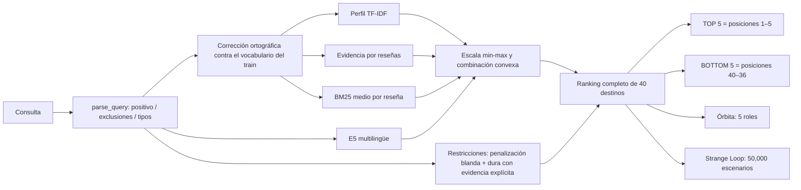

# Metodología, validación y defensa académica

Documento para quienes evalúan el proyecto. Cada afirmación remite a un artefacto reproducible
(`artifacts/*.json`) o a una prueba (`tests/`). Lo que todavía no está demostrado se dice
explícitamente en §10.

> **Inspiración vs. fundamento.** El vocabulario “multiverso”, “futuros”, “colapso” o “Strange
> Loop” es narrativo. El fundamento es estándar: recuperación de información con evaluación tipo
> Cranfield, un modelo de utilidad aleatoria con prior Dirichlet, estimación de Monte Carlo y
> teoría de la información (entropía de Shannon y ganancia de información).



## 1. ¿Cómo funciona matemáticamente el recomendador?

Datos: solo `data/Rest-Mex_2025_train_clean.csv`. Son 208,051 reseñas de 40 pueblos; el SHA-256
está en `artifacts/manifest.json` y lo verifica `tests/test_contract.py`.

Para una consulta $q$ y un destino $d$ se calculan cinco señales, cada una escalada a $[0,1]$
entre los 40 destinos: $\tilde s(d) = (s(d) - \min s)/(\max s - \min s)$.

| Señal | Definición |
|---|---|
| Perfil TF-IDF $s_{lex}$ | $0.78\cos(\mathbf q, \mathbf p_d) + 0.22\max_{k} \cos(\mathbf q, \mathbf p_{d,k})$. $\mathbf p_d$ es el centroide de las reseñas de $d$, ponderado por polaridad $w_r = 0.35 + 0.65(\text{pol}_r - 1)/4$ y normalizado L2. $k$ ∈ {atracción, hotel, restaurante}. |
| Evidencia $s_{evi}$ | $0.65\max + 0.35\,\overline{\text{top-}3}$ del coseno entre $\mathbf q$ y una muestra estratificada de reseñas positivas de $d$ (40 por pueblo y tipo). |
| BM25 medio $s_{bm25}$ | $\sum_{t\in q} \mathrm{idf}(t)\,\frac{1}{n_d}\sum_{r\in d}\frac{tf(r,t)(k_1+1)}{tf(r,t)+k_1(1-b+b\,|r|/\overline{|r|})}$, con $k_1=1.2$ y $b=0.75$. |
| Semántica $s_{sem}$ | Máximo coseno entre el embedding E5 de la consulta y los perfiles textuales de $d$. |
| Cobertura de facetas $s_{cov}$ | $\sum_G \mathrm{idf}_G \log\big(1 + r(d,G)/(m(G)+10^{-3})\big) / \sum_G \mathrm{idf}_G$, con $r(d,G)$ y $m(G)$ definidos en §2. Premia al destino que habla de **cada** faceta de la consulta más que el destino típico; el peso idf hace que una faceta rara ("termales") pese más que una genérica ("tranquilo"). |

Puntaje compatible: $u(d) = \sum_i w_i\,\tilde s_i(d) - 0.28\,\pi(d) - \mathbb 1[d \text{ viola}] - \mathbb 1[d \text{ excluido por nombre}] + 0.35\,\mathbb 1[d \text{ nombrado}]$.
El reportado es $\tilde u(d)\in[0,100]$.

- **Modo léxico** (Docker y producción): $w = (0.30, 0.20, 0.50)$ para (TF-IDF, evidencia,
  cobertura). Frente al anterior $(0.68, 0.32)$ sube el MRR de prueba del holdout de 0.511 a 0.575
  (ΔMRR +0.063, IC95 [+0.035, +0.093]) y el Hit@1 de 0.396 a 0.471 (§4).
- **Pesos híbridos:** $w = (0.20, 0.30, 0.10, 0.40)$ para (evidencia, BM25, E5, cobertura),
  elegidos en calibración (§4). Empatan con el léxico (MRR 0.572): E5 ya no aporta mejora medible.
- Los sinónimos de dominio adicionales (lago, termales, café…) se probaron y **se descartaron**:
  bajaban el MRR del holdout de calibración (0.597 → 0.592) y el P@5 del gold de ajuste.
- **Penalización blanda** $\pi$: afinidad escalada con el concepto excluido.
- **Restricción dura:** se aplica solo si hay **evidencia explícita** (§3).

$\tilde u$ es una **compatibilidad relativa dentro de la consulta**: no es una probabilidad de
satisfacción, y no se puede comparar entre consultas.

## 2. ¿Por qué esos cinco mejores y esos cinco peores?

Se ordenan los 40 destinos por $\tilde u$ descendente, con desempate determinista por orden
alfabético (`np.lexsort`).

- **TOP 5:** posiciones 1–5.
- **BOTTOM 5:** posiciones 40, 39, …, 36. Es exactamente el reverso del mismo orden, así que con
  $5+5 \le 40$ es imposible que un destino aparezca en ambas listas, incluso con empates (prueba
  `test_boundary_ties_keep_top_and_bottom_disjoint_and_consistent`).

“Peor” significa **menor compatibilidad con la consulta**, no peor destino. La calidad percibida
(polaridad media con prior bayesiano de 200 reseñas) se muestra aparte, y una prueba verifica que
no altera el orden (`test_quality_is_reported_but_not_used_for_ranking`).

Cada tarjeta explica su posición con hechos calculados (`explain.py`). Sea $r(d,G)$ la fracción de
reseñas de $d$ que mencionan algún término del grupo $G$, y $m(G)$ su mediana entre los 40
destinos:

- **Satisface** $G$ si $r \ge \max(2m, 0.5\,\%)$; **respaldo débil** si $0 < r$ queda por debajo.
- **Sin evidencia** si $r = 0$. Es *ausencia de menciones*, que no equivale a incompatibilidad.
- **Restricción incumplida** si $r(d, G_{excl}) \ge \max(2m, 1\,\%)$. Se muestra la reseña real que
  lo demuestra; nunca se usa una reseña positiva para justificar que un destino esté abajo.

## 3. ¿Qué aporta cada señal? Restricciones y lenguaje

Ablación en el holdout de prueba (280 consultas; `artifacts/experiments_hybrid.json`):

| Sistema | MRR | Hit@1 | Hit@5 | Correcto en bottom 5 |
|---|---|---|---|---|
| Perfil TF-IDF | 0.495 | 0.368 | 0.621 | 0.021 |
| Evidencia | 0.316 | 0.196 | 0.418 | 0.029 |
| BM25 medio | 0.466 | 0.336 | 0.604 | 0.025 |
| E5 | 0.253 | 0.146 | 0.314 | 0.046 |
| Léxico actual | 0.511 | 0.396 | 0.614 | 0.011 |
| Híbrido anterior (0.38/0.17/0.45 E5) | 0.468 | 0.346 | 0.600 | 0.011 |
| **Híbrido adoptado** | **0.526** | **0.404** | **0.668** | 0.014 |

Interpretación: E5 sola es la señal más débil en esta tarea, y darle un 45 % de peso empeoraba
el sistema. Con 10 % conserva su función, que es responder cuando la consulta no tiene
vocabulario del train. Esta tarea usa reseñas largas como consultas, lo que puede subestimar el
valor de E5 ante paráfrasis cortas. Por eso la evaluación humana (§5) es la evidencia decisiva.

Correcciones de lenguaje introducidas, cada una medida:

| Cambio | Evidencia |
|---|---|
| Exclusión al inicio (“Sin playa, quiero…”) ya no niega toda la frase | Robustez mínima de 0.00 a 0.43 (Jaccard top 5) |
| “sin duda / sin embargo…” ya no son exclusiones | Afectaban al 12 % de las reseñas del holdout; Hit@5 se recupera de 0.597 a 0.638 |
| Restricción dura por evidencia, no por cuantil fijo | Antes Órbita y Strange Loop excluían siempre 14 pueblos; con “sin playa” ahora excluyen los 8 con evidencia |
| Corrección ortográfica fonética | Neutra en holdout (ΔMRR +0.002, IC95 [−0.003, +0.009]); corrige “plallas → playas” |
| Tokenización E5 consistente | Los embeddings viejos usaban `fix_mistral_regex=False` y las consultas `True`; ahora coinciden y re-codificar da diferencia 0.0 |

## 4. ¿Cómo se evalúa la relevancia real?

Tres fuentes, de menor a mayor validez:

1. **Seed heurístico** (`eval/gold_queries.json`, 40 consultas). Su autor vio resultados del
   sistema, así que está sesgado a favor y solo sirve para detectar regresiones.
2. **Holdout autosupervisado.** Se reservan 600 reseñas (15 por pueblo), se reconstruye el índice
   sin ellas y se enmascaran nombres de pueblo y región. La tarea es recuperar el pueblo autor.
   No usa consultas escritas a mano. La caché se invalida si cambian el CSV, el código o sklearn.
3. **Evaluación humana ciega** (§5): la única medida directa de compatibilidad consulta–destino.

Selección de pesos: el holdout se divide en mitades estratificadas por pueblo (calibración 320 y
prueba 280). Se busca en una rejilla de 286 combinaciones convexas con paso 0.1, solo en
calibración, y se reporta en prueba con bootstrap pareado (5,000 remuestreos). **Criterio
primario fijado de antemano: MRR**, la métrica con la que se selecciona. Un cambio se adopta solo
si su IC95 de ΔMRR excluye 0.

| Comparación en prueba | ΔMRR (IC95) | ΔHit@5 (IC95) | Decisión |
|---|---|---|---|
| Híbrido adoptado vs híbrido anterior | **+0.058** [+0.028, +0.088] | +0.068 [+0.021, +0.111] | Adoptado |
| Híbrido adoptado vs léxico | +0.014 [−0.006, +0.035] | +0.054 [+0.025, +0.082] | Empate en MRR |
| Léxico ajustado (0.50/0.20/0.30 BM25) vs léxico actual | +0.011 [−0.010, +0.031] | +0.046 [+0.021, +0.075] | **No adoptado** |

El léxico ajustado mejora el Hit@5 de forma significativa, pero no el criterio primario.
Adoptarlo por la métrica secundaria sería elegir la métrica después de ver el resultado. Queda
como hipótesis a confirmar con los juicios humanos de la partición calibration.

Métricas finales (`make evaluate-full`, modo léxico con cobertura de facetas, el de producción):

| Fuente | Métrica | Sistema | Popularidad | Azar |
|---|---|---|---|---|
| Holdout (600) | Hit@1 | 0.475 | 0.025 | 0.025 |
| Holdout (600) | Hit@5 | 0.708 | 0.125 | 0.125 |
| Holdout | MRR | 0.587 | 0.107 | — |
| Holdout | Pueblo correcto en bottom 5 | 0.015 | 0.125 | 0.125 |
| Seed | Precision@5 (11 consultas con ≥5 relevantes) | 0.927 | — | — |
| Seed | Violaciones de exclusión en top 5 | 0.000 | 1.000 | 0.422 |

**Sesgo por volumen:** Spearman entre apariciones en el top 5 y número de reseñas es ρ = 0.17
(p = 0.30; antes de la cobertura era 0.30), y entre Hit@5 por pueblo y reseñas en el holdout ρ = 0.25. Es leve y no
significativo. Los perfiles promedian por pueblo y BM25 promedia por reseña precisamente para que
Tulum (45,345 reseñas) no gane por volumen.

## 5. ¿Cómo funciona la evaluación humana?

Procedimiento operativo en `docs/protocolo_evaluacion_humana.md`. El diseño, en `lab.py`:

- **Particiones** por hash estable del id: dev 50 %, calibration 25 %, test 25 %.
  `tuning_queries()` excluye test por construcción.
- **Pools** congelados en `eval/pools.json`: unión del top 5 y el bottom 5 de léxico, TF-IDF,
  BM25, popularidad, híbrido y E5, más 3 destinos de las posiciones 11–30 para detectar falsos
  negativos. Los juicios son por (consulta, destino) y sirven para evaluar cualquier sistema.
- **Ceguera:** orden barajado por evaluador; sin sistema, posición ni puntuación. Junto al destino
  solo se muestran temas y reseñas que no dependen de la consulta (prueba
  `test_pool_contains_both_ends_of_each_system_and_task_is_blind`).
- **Escala 0–3** y, aparte, restricción (cumple / incumple / no aplica / no sé), evidencia
  insuficiente y nota.
- **Métricas humanas:** nDCG@5 graduado, P@5 (rel ≥ 2), relevancia media del bottom 5, bottom 5
  mal ubicados, errores de restricción en el top 5 y falsos negativos en la zona media. Los no
  juzgados cuentan como desconocidos, no como irrelevantes.
- **Acuerdo:** kappa de Cohen cuadrática por pares y alfa de Krippendorff (ordinal, intervalo y
  nominal para restricciones). La implementación reproduce los valores publicados del ejemplo de
  Krippendorff (2011): 0.743 / 0.815 / 0.849 (`tests/test_lab.py`).
- **Aprendizaje activo:** en dev y calibration se prioriza el desacuerdo entre sistemas y las
  consultas con restricciones, con 30 % de muestreo aleatorio para no evaluar solo casos
  difíciles. En test el orden es siempre aleatorio.

**Estado: todavía no hay juicios humanos.** No se ha inventado ninguno. Todas las tablas humanas
del reporte aparecen vacías hasta que participen evaluadores.

## 6. Átomos de gusto

`_extract_facets` convierte la parte positiva de la consulta en hasta 5 facetas:

- conceptos turísticos con expansión controlada (playa, cenote, vino, bosque…);
- **intenciones abstractas agrupadas** (`FACET_CONCEPTS`: romántico, familia, vida nocturna,
  descanso, vistas, aventura, lago y río, café, artesanía). Antes, “niños pequeños, actividades
  para la familia” producía cuatro átomos (*pequeños, actividades, niños, familia*) que
  “competían” sin competir y abrían futuros artificiales; ahora es un solo átomo *familia*. Solo
  afecta a Órbita y Strange Loop: el ranking 5 + 5 no cambia (sus métricas siguen idénticas);
- las palabras de la consulta más raras del corpus (mayor idf), sin relleno como “quiero”,
  “viaje”, “vida”, “pequeños” o “altura”.

Las pruebas `tests/test_orbit_eval.py` fijan estos casos y verifican que los sustantivos
concretos (“museos”, “mezcal”) siguen saliendo del idf.

Cada faceta $f$ tiene una fila $M[f,d] = 0.68\,\tilde s_{lex} + 0.32\,\tilde s_{evi}$ calculada
con la sonda léxica de la faceta.

## 7. Órbita: los cinco futuros y los contrafactuales

$r$ es la compatibilidad del ranking 5 + 5; $R$ y $W$ son la media y el mínimo de la utilidad de
rango al eliminar cada faceta; $\rho$ es el riesgo. Las fórmulas exactas están en
`futures.ROLE_DEFINITIONS` y se devuelven en `method.definitions`:

- **Ancla** $=\arg\max r$. Coincide con el top 1 (prueba).
- **Superviviente** $=\arg\max 0.38r + 0.42R + 0.20W$.
- **Portal:** maximiza novedad (distancia de coseno al Ancla) con un umbral de plausibilidad
  $r \ge$ cuantil$(0.60 - 0.35\rho)$.
- **Especialista:** maximiza $\max_f M - \overline{M}$.
- **Comodín:** equilibra $r$, $R$, $\min_f M$ y la distancia.
- **Diversidad:** penalización $0.18\rho\cdot$ distancia media a los ya elegidos. Ningún rol
  posterior al Ancla puede incumplir una restricción con evidencia.
- **Estabilidad verificable:** % de 2,000 perturbaciones $w\sim\mathrm{Dir}(20/K)$ en que el
  destino sigue en el top 10. Ejemplo (colonial, sin playa): Ancla 100 %, Superviviente 100 %,
  Especialista 0.9 %. El Especialista es frágil por diseño.

**Contrafactual mínimo.** Sea $\Delta_f = M[f,d] - M[f,a]$. Al trasladar una fracción $s$ de la
atención uniforme hacia la mejor faceta $f^*$, el destino empata con el Ancla cuando
$(1-s)\bar\Delta + s\Delta_{f^*} = 0$, es decir, $s^* = -\bar\Delta/(\Delta_{f^*} - \bar\Delta)$
(prueba `test_counterfactual_shift_solves_the_tie_equation`).

- Si $\Delta_{f^*} \le 0$, ninguna redistribución basta.
- Si $d$ incumple una restricción, el caso es **imposible bajo las restricciones**.
- El contrafactual opera en el espacio de facetas léxicas: no incluye E5 ni las penalizaciones.

**Bottom 5 en Órbita:** `bottom_perspective` aplica este cálculo a los 5 menos compatibles sin
forzarlos a ocupar roles.

## 8. Strange Loop: qué representan los 50,000 escenarios

Modelo, devuelto en `model` por la API:

- **Pesos:** $w \sim \mathrm{Dirichlet}(\alpha\mathbf 1_K)$ con $\alpha = (28 - 24\rho)/K$. Es un
  prior no informativo y simétrico sobre cómo repartir la atención entre facetas; con más riesgo
  baja la concentración y las preferencias se vuelven más extremas. No se supone que los gustos
  humanos sigan esta distribución: es un dispositivo de exploración.
- **Utilidad:** $U(d) = 0.16\,r(d) + 0.84\sum_f w_f M[f,d] + \varepsilon_d$, con
  $\varepsilon \sim \mathrm{Gumbel}(0, 0.015 + 0.065\rho)$. Dado $w$, $\arg\max U$ es un logit
  multinomial.
- **Restricción dura:** $U(d) = -\infty$ si hay evidencia explícita de incumplimiento.
- **Frecuencia simulada:** $\hat p_d = k_d/N$ es la fracción de ponderaciones posibles en que $d$
  es el mejor. **No es una probabilidad real de satisfacción.**

**¿Por qué 50,000?** (`artifacts/multiverse_audit.json`, 5 consultas, referencia N = 200,000):

| N | Máx. diferencia de proporción (pp, peor consulta) |
|---|---|
| 1,000 | 1.42 |
| 5,000 | 0.83 |
| 10,000 | 1.03 |
| 50,000 | 0.30 |
| 100,000 | 0.36 |

- El error estándar de peor caso es $0.5/\sqrt N$ = 0.22 pp con N = 50,000.
- Entre 10 semillas, la desviación estándar máxima de una proporción es 0.22 pp y el destino líder
  coincide en 10 de 10.
- Más allá de 50k la mejora queda por debajo de la variación entre semillas. La API devuelve el EE
  y el IC95 de cada proporción.

**Incertidumbre:** $H = -\sum_d \hat p_d \ln \hat p_d / \ln 40 \in [0,1]$. Está validada en
casos extremos: 0 con un solo destino, 1 con uniforme y $\ln 2/\ln 40$ con dos. Aumenta de forma
monótona con el riesgo en las 5 consultas auditadas (por ejemplo, de 0.03 a 0.38 en playa).

**Preguntas de sacrificio.** Para cada par de facetas $(i, j)$, la partición $w_i \ge w_j$ divide
los escenarios. Se elige la de mayor
$IG = H - \sum_b \frac{n_b}{n} H_b$ (ponderada por equilibrio, con ramas de al menos 12 %).

**Colapso.** Responder conserva solo los escenarios con $w_{keep} \ge w_{sacrifice}$ y lo recalcula
todo. La prueba `test_information_gain_and_collapse_are_consistent` verifica que los supervivientes
anunciados coincidan exactamente y que la IG reportada sea igual a $H - \sum_b p_b H_b$, calculada
colapsando de verdad cada rama. La interfaz muestra el ranking antes y después.

**Bottom 5 en el multiverso** (`bottom_in_multiverse`):

- % de escenarios en que sigue en el bottom 5, entra al top 5 o gana;
- desviación de su posición;
- qué faceta domina en los escenarios donde se vuelve competitivo.

Los bloqueados por una restricción se reportan como excluidos en el 100 %. Su orden relativo
entre sí no tiene significado y no se informa.

**Trayectorias de tres viajes:** exploración especulativa, sin capacidad predictiva psicológica
(lo dice la API en `disclaimer`).

## 8 bis. Validación sin humanos: usuarios simulados y sensibilidad de roles

`make validate-orbit` → `artifacts/orbit_validation.json` (65 consultas: banco + auditoría + el
ejemplo del video; modo léxico; 100 usuarios por consulta).

**Usuarios simulados para Strange Loop.** Cada usuario tiene un peso de gustos oculto $w^*$; su
destino ideal es $\arg\max_d 0.16\,r(d) + 0.84\,w^{*\top}M[\cdot,d]$. Responde con honestidad
(“conservo la faceta con mayor $w^*$”) y medimos si el destino más frecuente del multiverso
restante es su ideal. Dos poblaciones: *prior* (el $w^*$ sale del mismo Dirichlet que el modelo:
caso optimista) y *concentrada* ($\alpha=0.35$: gustos dominados por una faceta, el modelo está
mal especificado). Se promedia por consulta; IC95 bootstrap sobre consultas.

| Acierto del destino ideal (Hit@1) | Prior | Concentrada |
|---|---|---|
| Ancla (top 1 clásico) | 65.0 % | 53.9 % |
| Strange Loop, 0 preguntas | 84.9 % | 63.6 % |
| + 1 pregunta informativa / al azar | 88.9 % / 87.2 % | 68.3 % / 66.5 % |
| + 3 preguntas informativas / al azar | **91.8 %** / 90.7 % | **73.2 %** / 70.7 % |
| Mejora con 3 preguntas vs 0 (IC95) | +6.9 pp [4.0, 10.1] | +9.6 pp [5.8, 13.7] |
| Informativa − azar con 3 preguntas (IC95) | +1.1 pp [0.3, 2.0] | +2.5 pp [1.2, 4.0] |

Lectura: (1) agregar sobre posibles pesos acierta más que el ranking promedio, incluso con la
población mal especificada; (2) cada pregunta aporta, y la de máxima información aporta más que
una al azar, con IC que excluye 0. En 40 de 61 consultas preguntar no cambia nada porque todas
las facetas apuntan al mismo pueblo (p. ej. “vino, viñedos, bodegas”): eso es correcto, no hay
nada que desempatar. **Límite:** el usuario simulado usa la misma utilidad que el modelo; esto
prueba coherencia interna y eficiencia de las preguntas, no satisfacción real. Eso lo mide el
laboratorio humano (§5).

**Sensibilidad de los pesos de rol.** Los 13 coeficientes de `ROLE_WEIGHTS` se multiplican a la vez
por factores $U(0.5, 1.5)$ (200 sorteos por consulta):

| Rol | Conserva el mismo destino |
|---|---|
| Ancla | 100 % (no tiene pesos) |
| Superviviente | 92.8 % |
| Especialista | 88.4 % |
| Portal | 86.3 % |
| Comodín | 79.2 % |

La cartera completa coincide en Jaccard medio 0.92 y es idéntica en el 76.6 % de los sorteos.
Moviendo un solo coeficiente ±50 %, ningún rol cambia en más del 7 % de las consultas (el más
sensible es la mezcla del Portal). Conclusión: los pesos son de diseño, pero las decisiones no
dependen de su valor exacto; el Comodín, que por definición equilibra cuatro criterios, es el
más sensible, como cabe esperar.

## 9. Reproducibilidad

```bash
make setup                # Python 3.9 de CLT + versiones fijadas
make build-semantic       # índices + E5 (rankings léxicos idénticos byte a byte entre rebuilds)
make test                 # 48 pruebas
make evaluate-semantic    # seed + holdout + ablación + adversarial → docs/evaluation_report.md
python scripts/experiments.py          # comparación de señales → docs/experimentos_hybrid.md
python scripts/audit_multiverse.py     # convergencia, semillas, riesgo
python scripts/validate_orbit.py       # usuarios simulados + sensibilidad de roles (~90 s)
make benchmark-api && make smoke-e2e
```

## 10. Ventajas demostradas y limitaciones

**Demostrado con datos:**

- Supera con amplitud a popularidad y azar: Hit@5 0.708 frente a 0.125 en el holdout.
- El nuevo híbrido es significativamente mejor que el anterior.
- El bottom 5 casi nunca contiene al destino correcto (1.5 % frente a 12.5 % al azar).
- Las restricciones se respetan en el top 5 del seed.
- Strange Loop es reproducible: hay convergencia medida, la IG es consistente y el colapso es real.
- Con usuarios simulados, Strange Loop acierta el destino ideal más que el top 1 clásico (84.9 %
  frente a 65.0 %) y 3 preguntas informativas suben a 91.8 %, mejor que preguntas al azar (§8 bis).

**Limitaciones abiertas:**

1. **No hay juicios humanos todavía.** Ni el seed ni el holdout miden directamente “compatibilidad
   con la consulta de una persona”.
2. El holdout usa reseñas como consultas, que son más largas y distintas de lo que escribe un
   usuario.
3. El seed está sesgado a favor del sistema.
4. Los umbrales de evidencia (2× mediana, 0.5 % / 1 %) son heurísticos razonados, no calibrados
   con humanos. Deben ajustarse en la partición calibration.
5. El contrafactual ignora E5 y las penalizaciones.
6. Los pesos de los roles de Órbita y los parámetros Dirichlet/Gumbel son de diseño, no estimados.
   Mitigado: la cartera es robusta a ±50 % en todos los pesos a la vez (§8 bis), pero no están
   aprendidos de preferencias reales.
7. No se probaron lematización, cross-encoders ni modelos E5 más grandes. Con 40 destinos y sin
   juicios humanos no había forma de demostrar una mejora; quedan como siguientes experimentos.
8. La corrección ortográfica puede corregir mal palabras raras; las correcciones se muestran
   siempre al usuario.
